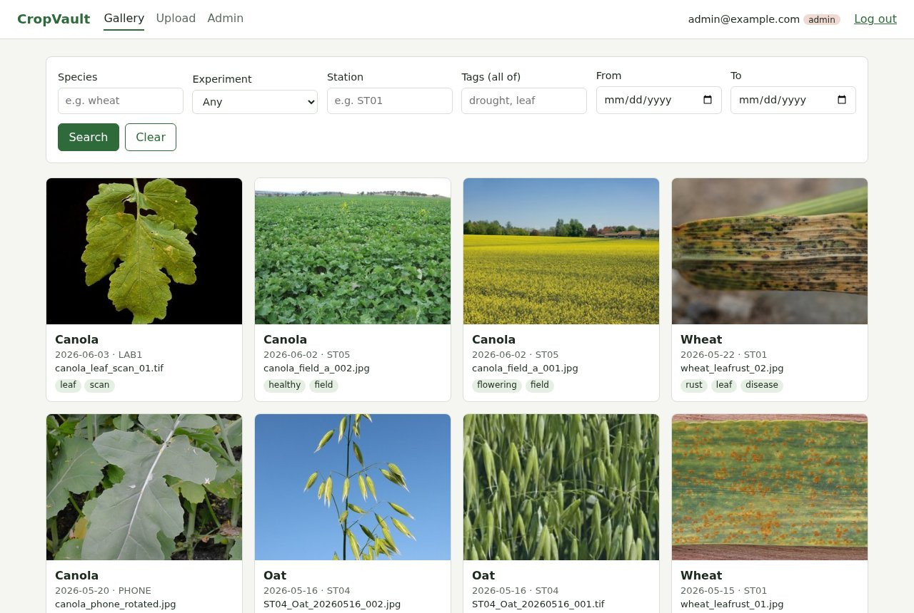
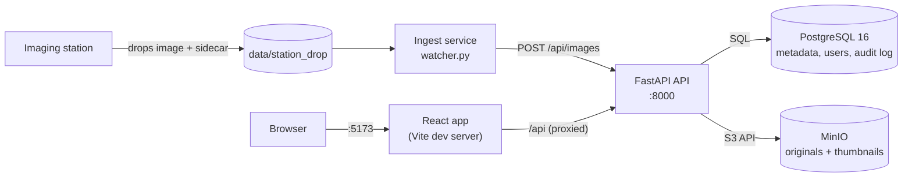
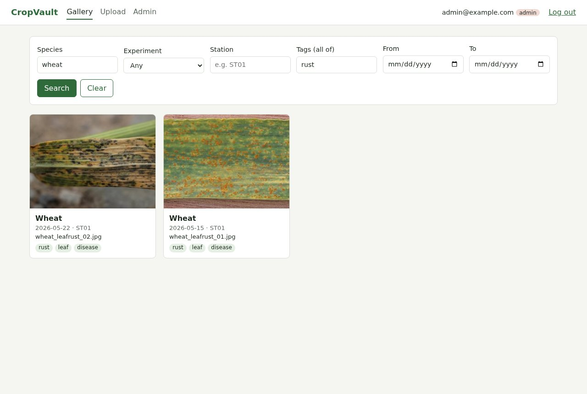
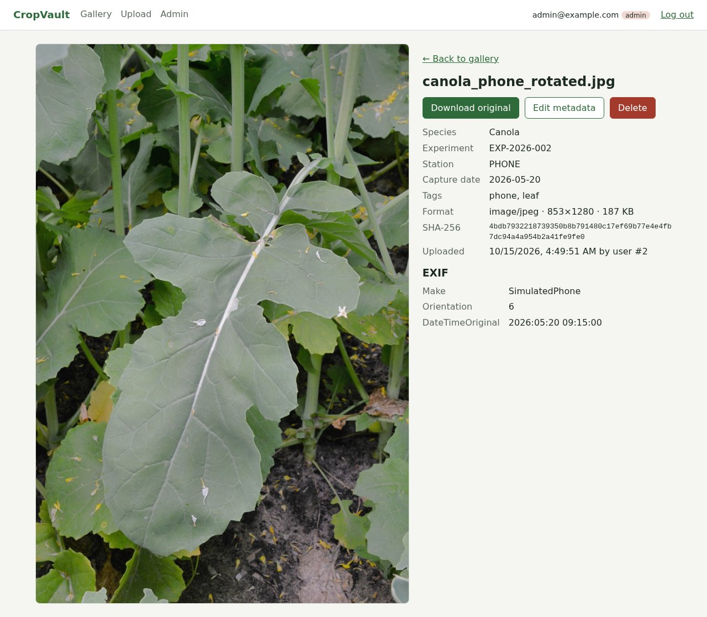
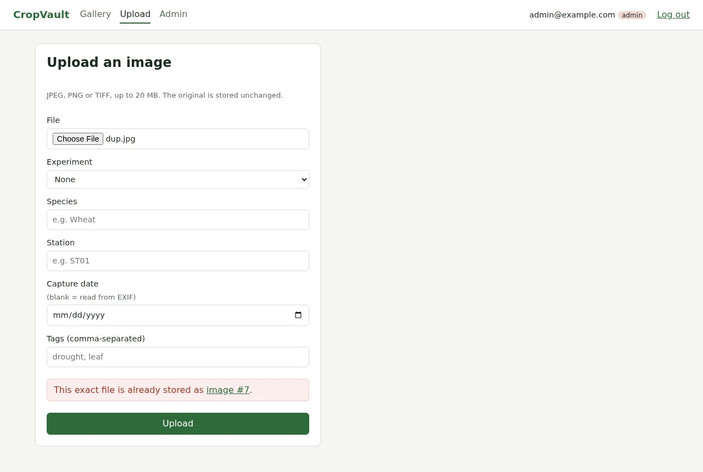
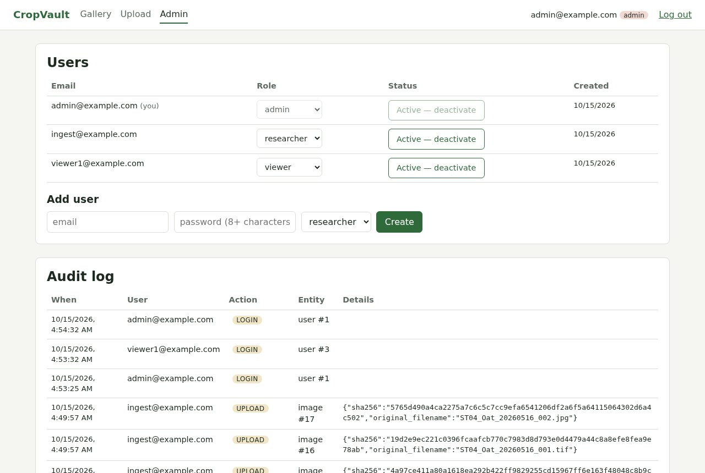
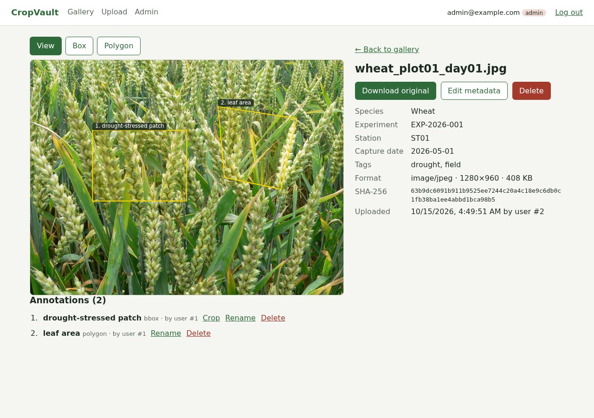
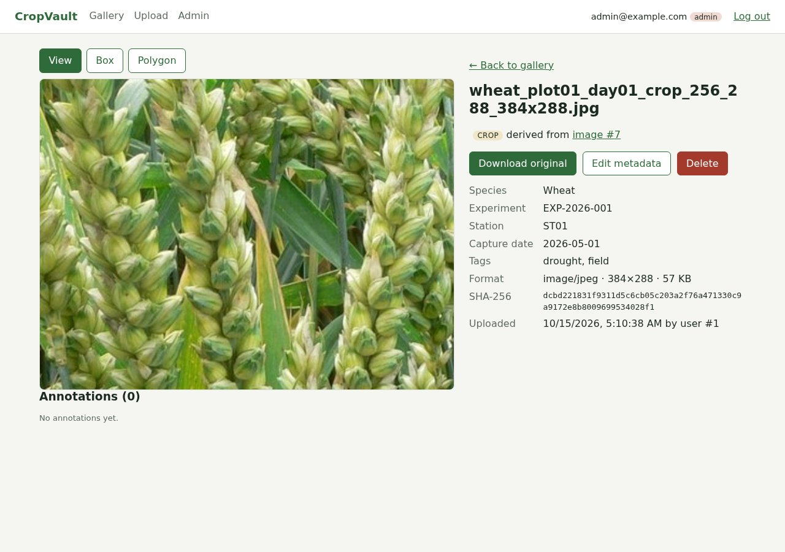
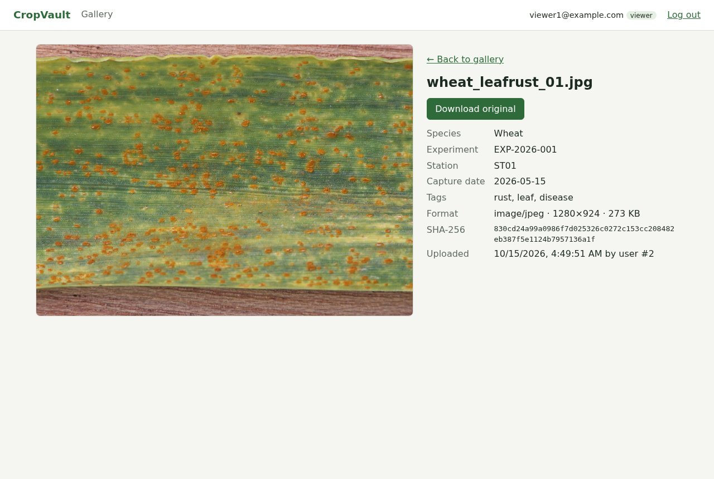

# CropVault

[](https://github.com/gill-amitoj/Cropvault/actions/workflows/ci.yml)

**An open-source image management system for plant-science research.** Imaging stations drop
crop photos into a folder; an ingestion service moves them into central storage; researchers
search, view and manage them in a web app with role-based access control. Every change is
recorded in an audit log.

> **Core question:** how do you reliably move research images from instruments into a
> searchable, access-controlled system without losing, duplicating or corrupting data?



## Features

- **Automatic ingestion.** Watches a drop folder, waits until each file is fully written, reads
  metadata from a JSON sidecar (or the filename), uploads through the API and retries with
  exponential backoff. Files end up in `processed/` or `failed/` with a written reason.
- **Safe uploads.** Files are validated by decoding their content (never trusting the extension),
  capped at 20 MB, protected against decompression bombs and de-duplicated by SHA-256.
- **Search.** Filter by species, experiment, station, tags and date range, with pagination, backed
  by PostgreSQL indexes.
- **Role-based access control.** Admin, researcher and viewer roles, enforced in the backend, with
  a test expecting `403` for every forbidden action.
- **Traceability.** Originals are never modified, and every upload, edit, delete, login and user
  change is written to an audit log in the same transaction as the change.
- **Annotations and crops.** Draw bounding boxes and polygons on an image (stored as 0-1 fractions,
  so they line up at any display size) and crop a region into a new image linked to its parent.
- **Web app.** Gallery, image detail with EXIF, upload, and admin pages for users and the audit log.
- **Runs locally with one command.** Five Docker containers, free and open-source software only.

## Architecture



| Service | Role |
|---|---|
| **ingest** | Watches the drop folder and uploads finished images through the API. It never touches the database or storage directly. |
| **api** | FastAPI app: authentication, role checks, validation, de-duplication, thumbnails, streaming, audit log. The only way into the data. |
| **db** | PostgreSQL 16 with plain SQL (no ORM): image metadata, users, experiments, audit log. |
| **minio** | S3-compatible object storage for the original files and their thumbnails. |
| **frontend** | React + TypeScript app. The browser talks only to it; `/api` is forwarded to the API. |

**Split storage:** PostgreSQL holds small, searchable records, including a `storage_key` that
points to the file; MinIO holds the image bytes. Searching never touches image bytes, and files are
streamed through the API only after a permission check, never from public storage URLs.

### What happens to one image

1. A station writes `leaf.jpg` and `leaf.json` (species, station, date, experiment, tags) into the drop folder.
2. The ingest service waits until the file's size and modification time are unchanged for 2 seconds.
3. It uploads the file and its metadata to `POST /api/images`, logged in as a researcher service account.
4. The API checks the token and role, the size, that the bytes really are a JPEG/PNG/TIFF, and whether the SHA-256 already exists (`409` with the existing id if so).
5. It stores the original and a 320 px thumbnail in MinIO, then inserts the database row and an audit entry; if the insert fails, it removes the stored objects.
6. The ingest service moves the file to `processed/` (a `409` duplicate counts as success, so reprocessing is always safe).

## Quick start

Requirements: Docker with Docker Compose.

```bash
git clone https://github.com/gill-amitoj/Cropvault.git && cd Cropvault
cp .env.example .env        # then edit .env: set your own passwords and JWT_SECRET
docker compose up --build
```

Then open **http://localhost:5173** and log in with the `ADMIN_EMAIL` and `ADMIN_PASSWORD` you set
in `.env`. The admin account is created on first startup; add researchers and viewers from the
**Admin** page.

> `.env` holds every secret and is ignored by git. Never commit it; only `.env.example`
> (placeholders) is in the repository.

| URL | What |
|---|---|
| http://localhost:5173 | Web app |
| http://localhost:8000/docs | Interactive API docs (Swagger) |
| http://localhost:9001 | MinIO console (log in with `MINIO_ROOT_USER` / `MINIO_ROOT_PASSWORD` from `.env`) |
| `localhost:5433` | PostgreSQL from the host (inside Compose it is `db:5432`) |

All ports are published on `127.0.0.1` only, so other devices on your network can't reach them.

### Try the ingestion pipeline

```bash
cp sample_data/station_drop/* data/station_drop/
docker compose logs -f ingest          # one line per file
```

The sample set contains **real crop photos from Wikimedia Commons** (credited in
[sample_data/CREDITS.md](sample_data/CREDITS.md)) arranged to exercise every path: sidecar
metadata, filename fallback, PNG and TIFF, an EXIF-rotated phone photo, a duplicate resend, and
five files that should end up in `failed/` (a text file named `.jpg`, an impossible date, an
unknown experiment, no metadata, an unsupported file type). See
[sample_data/README.md](sample_data/README.md).

## Screenshots

| Search: wheat with leaf rust | Image detail with EXIF |
|---|---|
|  |  |
| **Duplicate upload detected** | **Admin: users and audit log** |
|  |  |
| **Annotations: a box and a polygon** | **Crop saved as a new image linked to its parent** |
|  |  |
| **Viewer: read-only (no upload, edit or delete)** | |
|  | |

The detail screenshot shows a simulated phone photo stored sideways with EXIF orientation 6: it is
displayed upright and its capture date was read from EXIF.

## Roles and permissions

| Action | admin | researcher | viewer |
|---|---|---|---|
| Log in, view, search images | yes | yes | yes |
| Upload images | yes | yes | no |
| Edit image metadata | yes | own images only | no |
| Delete images | yes | own images only | no |
| Create experiments | yes | yes | no |
| Create annotations (on any image) | yes | yes | no |
| Edit / delete annotations | yes | own annotations only | no |
| Crop into a derived image (any image; the crop is yours) | yes | yes | no |
| Manage users and roles, view the audit log | yes | no | no |

Every rule is enforced in the backend. The UI hides actions a role can't use, but that is only
convenience: a request sent directly (for example with `curl`) is still rejected with `403`.

## How the hard problems are handled

| Problem | Solution |
|---|---|
| A station is still writing the file | Process only after size and mtime are unchanged for 2 s |
| The same image arrives twice | SHA-256 of the bytes + `UNIQUE` constraint; duplicate → `409` with the existing id, which the ingest service treats as success |
| Fake files (`.exe` renamed to `.jpg`) | Decode the bytes with Pillow; only real JPEG/PNG/TIFF accepted (`400` otherwise) |
| Huge files and decompression bombs | 20 MB limit checked from `Content-Length` *and* the real size (`413`); Pillow's bomb protection on |
| Photos stored sideways | Thumbnails apply EXIF orientation; the original bytes are never modified |
| Storage and database out of sync | Upload: object first, then row, delete objects if the insert fails. Delete: row first, then objects, log orphans |
| Hidden buttons are not security | Backend role and ownership checks, with a `403` test for every forbidden case |
| The browser can't reach `minio:9000` | Images are streamed through the API after the permission check |
| Unreliable filenames | Sidecar JSON first, filename pattern second, otherwise `failed/` with a reason file |
| EXIF dates have no timezone | `capture_date` stored as a `DATE` |
| Annotations drawn on a scaled-down image | Stored as fractions (0-1) of the displayed image, validated in the API; the SVG drawing layer uses the same 0-1 coordinates |
| Originals must never change | A crop is a new image (`parent_image_id`, `derivation = 'crop'`); the parent can't be deleted while crops exist |
| `` tags can't send a token | The frontend fetches images with the token and shows them as `blob:` URLs |

Every design choice, with the alternatives considered, is in
[docs/decisions.md](docs/decisions.md). Real problems hit during development, with root causes and
fixes, are in [docs/problems_log.md](docs/problems_log.md).

## API overview

All endpoints are under `/api`; errors are JSON `{"detail": ...}` with `400`, `401`, `403`, `404`,
`409`, `413` or `422`. Full interactive docs at http://localhost:8000/docs.

| Method | Path | Who |
|---|---|---|
| POST | `/auth/login` | anyone (returns a JWT) |
| GET | `/auth/me` | logged in |
| GET, POST | `/users` | admin |
| PATCH | `/users/{id}` | admin |
| GET | `/experiments` | logged in |
| POST | `/experiments` | admin, researcher |
| POST | `/images` (multipart upload) | admin, researcher |
| GET | `/images` (filters: `species`, `experiment`, `station`, `tags`, `date_from`, `date_to`, `page`, `page_size`) | logged in |
| GET | `/images/{id}`, `/images/{id}/file`, `/images/{id}/thumbnail` | logged in |
| PATCH, DELETE | `/images/{id}` | admin, or the researcher who uploaded it |
| POST | `/images/{id}/crop` (body: `x`, `y`, `width`, `height` in pixels) | admin, researcher |
| GET | `/images/{id}/annotations` | logged in |
| POST | `/images/{id}/annotations` (`bbox` or `polygon`, coordinates 0-1) | admin, researcher |
| PATCH, DELETE | `/annotations/{id}` | admin, or the researcher who created it |
| GET | `/audit` | admin |
| GET | `/health` | anyone (checks database and storage) |

## Tests and CI

```bash
docker compose exec api pytest -q                  # backend (real PostgreSQL test database)
docker compose exec ingest pytest -q               # ingestion service
docker compose exec frontend npm test              # frontend
docker compose exec api ruff check . && docker compose exec api ruff format --check .
```

299 automated tests at the time of writing: 216 backend, 48 ingestion and 35 frontend. Backend
tests run against a separate `cropvault_test` database with object storage faked; ingestion tests
use an injected clock and a mocked HTTP transport. GitHub Actions runs three jobs on every push:
backend (with a PostgreSQL service container), ingestion and frontend (lint, tests and a
type-checked build).

## Tech stack

Python 3.12 · FastAPI · PostgreSQL 16 (psycopg, plain SQL) · MinIO · PyJWT · argon2 · Pillow ·
watchdog · httpx · React 19 · TypeScript · Vite · React Router · plain CSS · pytest · Vitest ·
React Testing Library · ruff · oxlint · Docker Compose · GitHub Actions

## Project structure

```
backend/        FastAPI app (app/) and pytest tests (tests/)
ingest/         watcher.py ingestion service and its tests
frontend/       React + TypeScript app (src/: api.ts, pages/, components/, test/)
db/             schema.sql and seed.sql, applied by the API on startup
sample_data/    real sample photos + sidecars, prepare_samples.py, CREDITS.md
docs/           decisions.md, problems_log.md, screenshots/
data/           runtime drop folder (gitignored, mounted into the ingest container)
```

## Configuration

All settings come from `.env` (copy `.env.example`). Replace every `change-me` placeholder with a
strong random value (`.env.example` shows a one-line generator): the placeholders are public.

| Variable | Purpose |
|---|---|
| `POSTGRES_DB`, `POSTGRES_USER`, `POSTGRES_PASSWORD` | Database name and credentials |
| `MINIO_ROOT_USER`, `MINIO_ROOT_PASSWORD`, `MINIO_BUCKET` | Object storage credentials and bucket |
| `ADMIN_EMAIL`, `ADMIN_PASSWORD` | First admin account, created on startup if missing (never overwritten) |
| `INGEST_EMAIL`, `INGEST_PASSWORD` | Researcher service account used by the ingest service |
| `JWT_SECRET`, `JWT_EXPIRE_MINUTES` | Token signing secret and lifetime (default 8 hours) |

## Known limitations

- **Local demo setup.** The frontend runs on Vite's development server and the stack is not
  hardened for production (no TLS, no reverse proxy, no login rate limiting).
- **Token storage.** The JWT is kept in `localStorage`; production would use httpOnly cookies with
  CSRF protection (trade-off documented in `docs/decisions.md`).
- **Annotation shapes are redrawn, not dragged.** The web app can create, rename and delete
  annotations; changing a shape means deleting and redrawing it (the API supports full edits).
- **Exact-duplicate detection only.** The same photo re-saved in another format or quality gets a
  new checksum and is stored again.
- **TIFF preview is low resolution.** Browsers can't display TIFF, so the detail page shows the
  320 px thumbnail and offers the original for download.
- **No migrations tool.** Changing an existing table requires `docker compose down -v`, which
  deletes all data.
- **Orphaned files are only logged.** Nothing cleans them up automatically.
- **No performance benchmarks.** Indexes are verified to be usable with `EXPLAIN`, not measured.

## Roadmap

- **Done: Stage 7.** Annotation canvas (bounding boxes and polygons) and crop to a derived image.
- **Optional: Stage 8.** OpenCV segmentation (Otsu threshold) saved as a derived mask image.
- **Later.** MinIO lifecycle rules, CSV export, a summary dashboard.

## License

The code is released under the [MIT License](LICENSE). The sample photos are not covered by it:
they keep their original Creative Commons or public-domain licences, listed with authors and
sources in [sample_data/CREDITS.md](sample_data/CREDITS.md).
